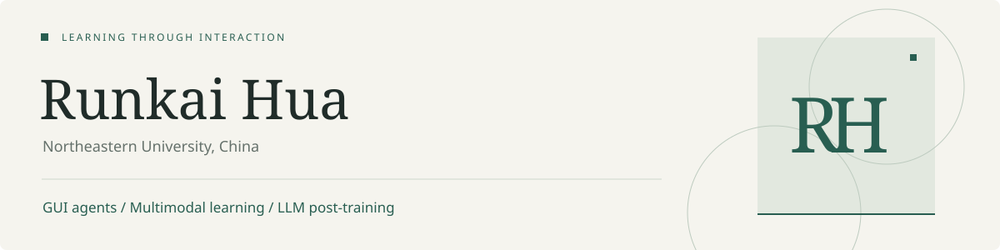

I'm **Runkai Hua (华润凯)**, a master's student in Computer Science and Technology at **Northeastern University, China**. I work on GUI agents, multimodal learning, and LLM post-training, with a particular interest in how agents learn from interaction and reuse experience across tasks.

**[Academic homepage · 中 / EN](https://huarunkai.github.io)** &nbsp; / &nbsp; **[Email](mailto:1248782899@qq.com)**

### Research

| Work | Focus | Status & role |
| :--- | :--- | :--- |
| **GUI-Evolver** | GUI data–model co-evolution through real-app exploration | Submitted to AAAI 2027 · Co-first author |
| **EXPlife** | Evidence-grounded experience lifecycles for LLM agents | Submitted to ICASSP · First author |
| **[TADUFMA](https://doi.org/10.1088/1361-6501/adf083)** | Adaptive denoising and multi-condition industrial anomaly detection | Measurement Science and Technology, 2025 · First author |
| **TVTTP** | Task-specific visual tracking with trajectory prompts | Under review at IEEE TNNLS · First student author |

### Open-source work

- **[Sico · microsoft/Sico](https://github.com/microsoft/Sico)** — Multi-agent execution, trajectory reflection, and reusable experience. My work includes the execution and self-evolution architecture.
- **[Sico Evolution · Released GUI model](https://huggingface.co/microsoft/GELab-Zero-4B-preview-Sico-Evolution)** — GUI agent post-training with online rollouts, expert corrections, and iterative evaluation.

### Background

**Education** &nbsp; Northeastern University, master's student (2026–2029 expected) · Wuhan Textile University, Artificial Intelligence (2022–2026).

**Internships** &nbsp; Microsoft Sico Lab (Jan 2026–present) · Qihoo 360 (Sep 2025–Jan 2026) · Huawei MindSpore (Jun–Sep 2024).

**Selected honors** &nbsp; National Scholarship · RoboCup China national first prize (team captain) · National silver awards in the Group Programming Ladder Tournament and Mati Cup Programming Contest.

More about my research and experience: <a href="https://huarunkai.github.io">huarunkai.github.io</a>
